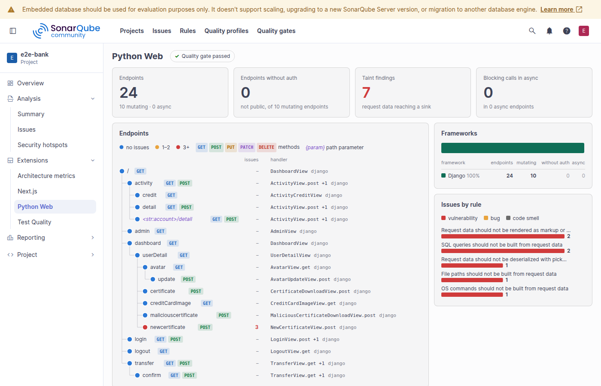

# Python web rules for SonarQube

A SonarQube plugin with framework-aware security and correctness rules for Django (Django REST framework included),
FastAPI and Flask, for SonarQube Community Build, whose bundled Python analyzer has no taint analysis. It builds a
model of the app's endpoints (routes, views, their authentication) and follows request data across functions and
modules to SQL, shell, file, URL fetch, redirect, template and deserialization sinks. Each issue names the endpoint
and shows the path as secondary locations.

The rules were validated on about 40 code bases: Django and DRF apps (netbox, saleor, zulip, wagtail, healthchecks,
taiga), FastAPI and Flask apps (polar, dispatch, full-stack-fastapi-template, flaskbb, redash), deliberately vulnerable
apps (pygoat, Vulnerable-Flask-App) and repositories found by code search. Every issue was reviewed by hand and every
false positive pattern fixed, so that each rule is right in at least 9 of 10 cases. The largest apps (saleor, zulip,
netbox) take about 12 s.

## Install

Requires SonarQube Community Build 26.7 or later (tested on 26.7 with the community branch plugin, pull requests
included, and on 26.10) and Java 21. Download `sonar-python-web-<version>.jar` from the
[releases](https://github.com/snake-in-prod/sonar-python-web/releases), copy it to `extensions/plugins/` and restart;
then assign the "Python Web" profile or add its rules to your own Python profile. To build it yourself: `./mvnw verify`. The plugin analyses py files of projects
that import Django, FastAPI, Starlette or Flask; other projects are skipped.

## Rules

Repository `pythonweb-python`, built-in profile "Python Web" (SonarQube allows one built-in "Sonar way" per language,
so activate the rules in your own profile, or extend "Python Web").

| Rule | Type | Severity | In profile |
|---|---|---|---|
| TaintedSql | Vulnerability | Critical | yes |
| TaintedCommand | Vulnerability | Critical | yes |
| TaintedPath | Vulnerability | Major | yes |
| TaintedUrlFetch | Vulnerability | Major | yes |
| OpenRedirect | Vulnerability | Major | yes |
| UnsafeTemplate | Vulnerability | Critical | yes |
| UnsafeDeserialization | Vulnerability | Critical | yes |
| EndpointWithoutAuth | Vulnerability | Major | yes |
| CsrfExemptMutation | Vulnerability | Major | yes |
| BlockingCallInAsync | Bug | Major | yes |
| MissingAwait | Bug | Critical | yes |
| MutableDefaultInModel | Bug | Major | yes |
| ResponseModelLeak | Vulnerability | Major | no |
| NPlusOneQuery | Code smell | Minor | no |

## Measures

pw_endpoints, pw_mutating_endpoints, pw_unprotected_endpoints (the endpoints EndpointWithoutAuth reports), pw_async_endpoints, pw_blocking_calls,
pw_taint_findings, and pw_endpoints_json (every endpoint with its path, methods, framework, function, auth, async flag
and issues) for the "Python Web" project page.

The "Python Web" project page shows the endpoints as a route tree with their methods, issues, missing auth and
handlers, the split by framework and the open issues by rule, on the branch or pull request being viewed:

See [docs/DESIGN.md](docs/DESIGN.md) for how it works and how to write a rule.

## License

Apache-2.0
